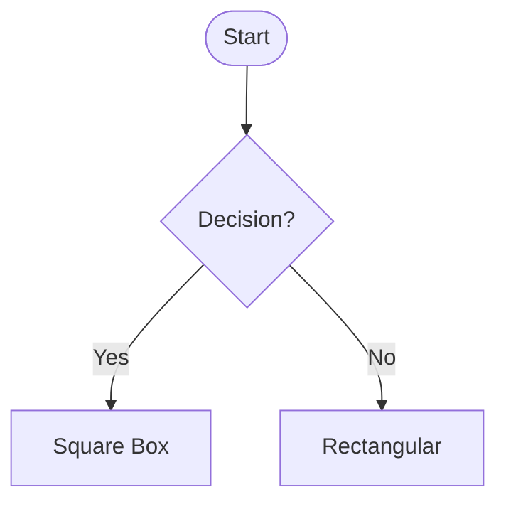
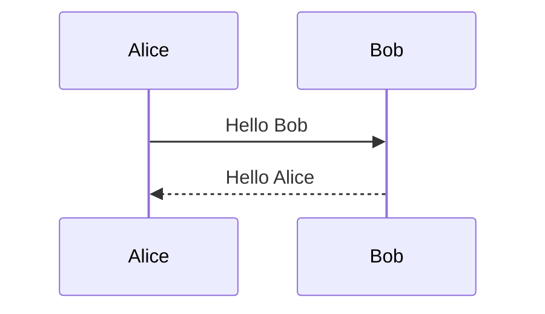

# Markdown syntax
## Headings
1. #Level 1 heading(Main title) 
2. ##Level 2 heading(Section header)
3. ###Level 3 heading(Subsection header)

## Text Styling and Footnotes Details
1. This is **bold text**
2. This is *Italic text*
3. This is ~~strikethrought~~

## Lists
### Bullet 
* Bullet point 1
* Bullet point 2
### Numbers
1. Number list 1
2. Number list 2
### Nested Bullets
* Main topic
    * Subtopic 1
    * Subtopic 2
        * Sub-Sub Topic 1
### Task lists
- [ ] Fill with a X if completed
- [X] the X signifies the corresponding task is completed


## Code formatting and Collapsible details
use the `conda activate`
``` python
for i in range(10):
    print(i**2 + 5) #comment 
    if i%2 == 0:
        print(i-1)
    else:
        break
``` 
<details>
<summary>Click here to view full installation logs</summary>

```powershell
Pip install qiskit-nature completed successfully.
Installing collected packages: qiskit-nature, qiskit-machine-learning
```
</details>

## Table, Blockquotes and Dividers
### Table
|1|2|3|
|:---|:---|:---|
|Chemistry|Physics|Math|
|Experimental|Both|Theoretical|

### Quotes
> Let the sun burn on the unholy, let the holy mf enjoy
### Divider
---
### Critical Notes
> **Use this for Critical Notes**

> [!NOTE]
> This is very important message and need to circulated across the whole campu as soon as possible 

> [!WARNING]
> Critical step here! Failing to activate the conda environment will crash the script.
## Misc

This combines ***bold and italic styles*** together.

Use <kbd>Ctrl</kbd> + <kbd>Shift</kbd> + <kbd>P</kbd> to open the palette.
### Mermaid





